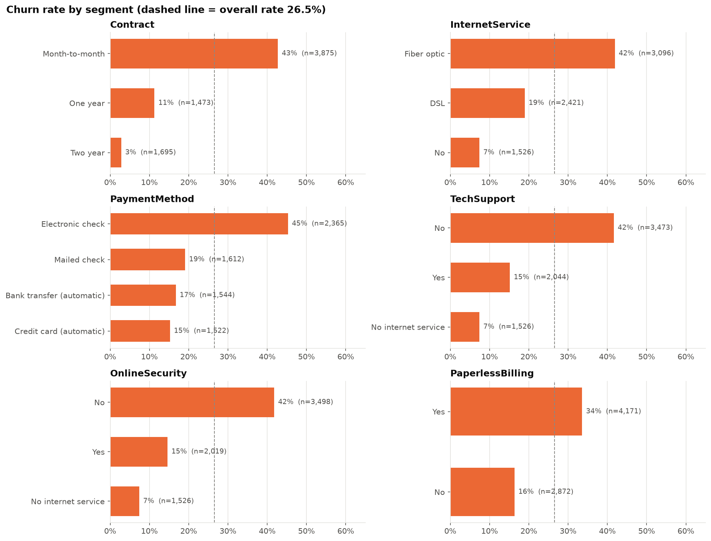
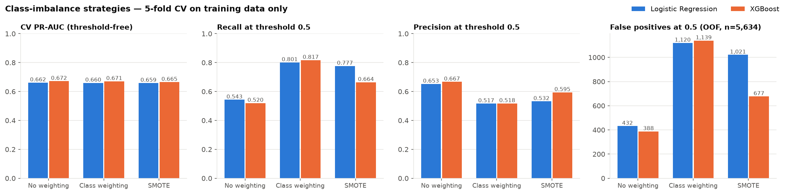
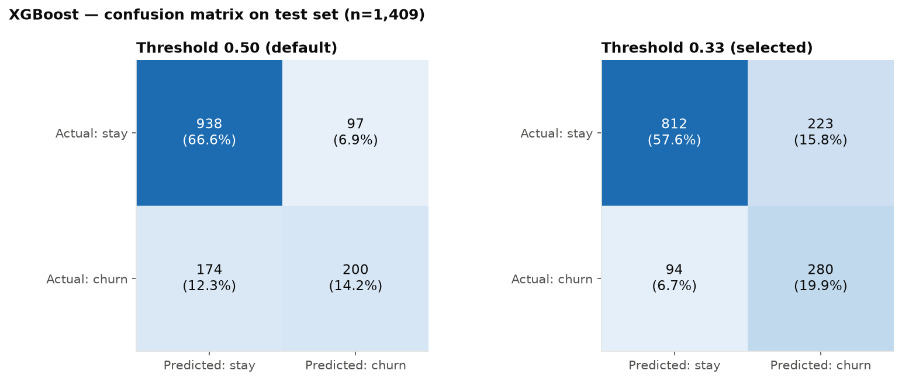
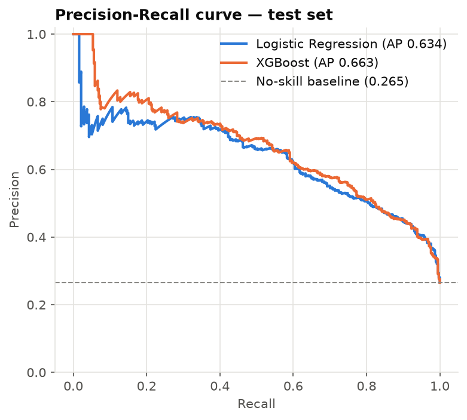
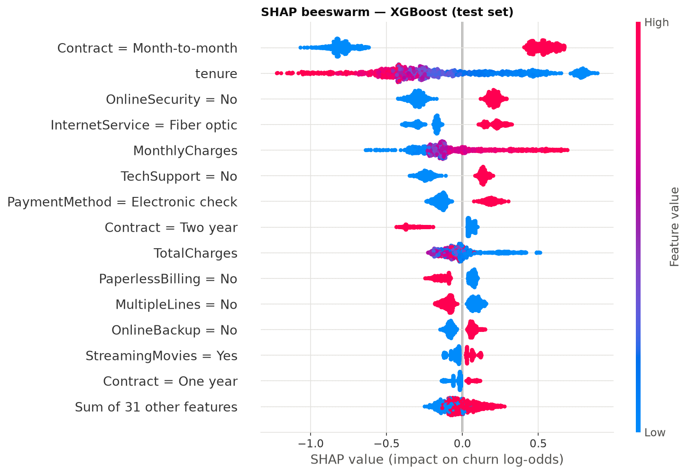
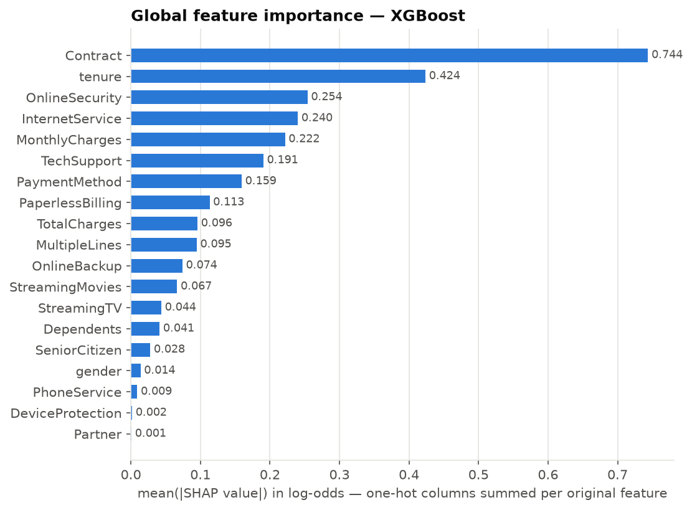
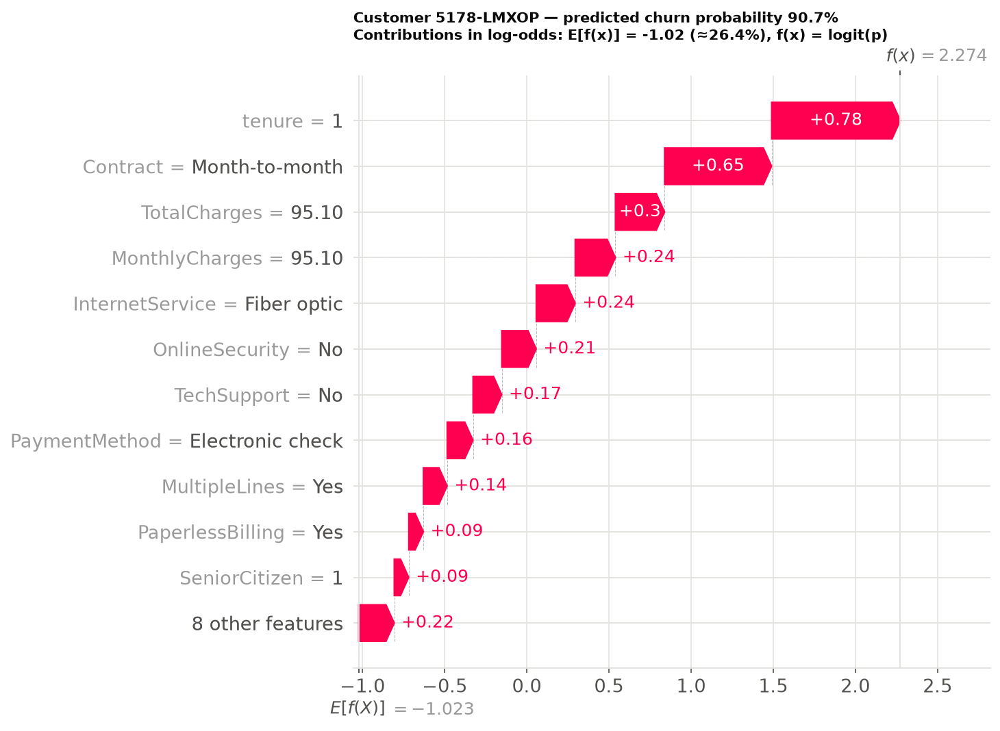

# Customer Churn Prediction — Machine Learning & Explainable AI

[](https://github.com/aav16/customer-churn-prediction/actions/workflows/tests.yml)


[](LICENSE)

End-to-end, reproducible machine-learning project that predicts which telecom customers are likely to
churn and uses **SHAP** to explain *why* each prediction was made.

| | |
|---|---|
| **Final model** | XGBoost (selected by cross-validated PR-AUC over Logistic Regression and 3 class-imbalance strategies) |
| **Test ROC-AUC / PR-AUC** | 0.848 / 0.663 (held-out 20%, 1,409 customers) |
| **Recall / Precision** | 0.749 / 0.557 at a validation-selected threshold of 0.33 |
| **Top-decile churn rate** | 75.2% of the 10% highest-scored test customers churned (base rate 26.5%) |
| **Top SHAP drivers** | Contract type, tenure, online security, internet service, monthly charges |

---

## 1. Project Overview

The project answers two business questions:

1. **Which customers are most likely to churn?** → a ranked table of customers with churn probability,
   predicted class, risk level and their personal top risk drivers
   ([`reports/customer_churn_predictions.csv`](reports/customer_churn_predictions.csv)).
2. **Why are these customers likely to churn?** → global and per-customer SHAP explanations
   ([`reports/figures/`](reports/figures/)).

It covers the full workflow: EDA, leakage-safe preprocessing, class-imbalance comparison, model
selection with cross-validation, threshold selection on validation data, final test evaluation,
explainability, business analysis, automated tests and documentation.

## 2. Business Problem

Acquiring a new telecom customer is usually much more expensive than keeping an existing one. A
retention team with a limited budget needs to know **whom to contact** and **what is driving each
customer's risk**, so that offers can be targeted. The two error types have different costs:

- **False negative** (a churner not flagged): the customer leaves without any retention attempt —
  the full customer value is lost.
- **False positive** (a loyal customer flagged): the cost of a contact/incentive that was not needed.

This asymmetry is why the classification threshold is tuned instead of using the default 0.5, and why
accuracy is not used to select models.

## 3. Dataset Description

[Telco Customer Churn](https://www.kaggle.com/datasets/blastchar/telco-customer-churn) (IBM sample
data): **7,043 customers × 21 columns**, one row per customer.

| Group | Columns |
|---|---|
| Identifier | `customerID` (never used as a feature) |
| Demographics | `gender`, `SeniorCitizen`, `Partner`, `Dependents` |
| Account | `tenure`, `Contract`, `PaperlessBilling`, `PaymentMethod`, `MonthlyCharges`, `TotalCharges` |
| Services | `PhoneService`, `MultipleLines`, `InternetService`, `OnlineSecurity`, `OnlineBackup`, `DeviceProtection`, `TechSupport`, `StreamingTV`, `StreamingMovies` |
| Target | `Churn` (Yes/No) — **26.5% Yes** |

**Source and attribution:** this is a **public dataset available on Kaggle**
([blastchar/telco-customer-churn](https://www.kaggle.com/datasets/blastchar/telco-customer-churn)),
originally published by IBM as sample data for customer-retention analysis. All credit for the data goes
to its original publishers. The CSV is **not redistributed** in this repository: download it from Kaggle
and place it at `data/WA_Fn-UseC_-Telco-Customer-Churn.csv` (see [`data/README.md`](data/README.md)).

## 4. Project Structure

```text
customer-churn-prediction/
├── .github/workflows/tests.yml   # CI: runs the pytest suite on every push
├── data/                         # raw CSV (git-ignored) + download instructions
├── notebooks/
│   └── 01_exploratory_analysis.ipynb
├── src/
│   ├── config.py                 # paths, columns, seeds, thresholds, economic assumptions
│   ├── data_preprocessing.py     # loading, validation, cleaning, split, ColumnTransformer
│   ├── train.py                  # CV grid search: models × imbalance strategies, threshold
│   ├── evaluate.py               # test metrics, plots, business scenarios, model_results.md
│   ├── explain.py                # SHAP (log-odds), global plots, waterfalls, top drivers
│   ├── predict.py                # ranked churn-risk table (CLI for new customers too)
│   ├── plotting.py               # shared, colour-blind-safe figure style
│   └── utils.py                  # logging and JSON helpers
├── tests/                        # pytest suite (synthetic data, no CSV needed)
├── models/                       # trained pipelines + metadata (git-ignored, regenerated)
├── reports/
│   ├── figures/                  # EDA, evaluation and SHAP figures
│   ├── model_results.md          # auto-generated metrics report
│   ├── customer_churn_predictions.csv
│   └── *.csv / test_metrics.json # CV results, SHAP importance, segments, scenarios
├── docs/
│   ├── methodology.md
│   └── business_insights.md
├── main.py                       # runs the whole pipeline
├── requirements.txt
├── LICENSE
└── README.md
```

`config.py`, `plotting.py` and `utils.py` were added to the suggested layout to avoid duplicating
constants, styling and helpers across modules.

## 5. Technologies Used

Python 3.12 · pandas 3.1 · NumPy 2.5 · scikit-learn 1.9 · XGBoost 3.4 · imbalanced-learn 0.14 ·
SHAP 0.54 · Matplotlib 3.11 · Seaborn 0.13 · SciPy · Jupyter · joblib · pytest 9 · Git.
Everything runs on CPU; no cloud services.

## 6. Installation and Setup

Windows 11 + PowerShell (from the project folder):

```powershell
# 0. Clone the repository
git clone https://github.com/aav16/customer-churn-prediction.git
cd customer-churn-prediction

# 1. Create and activate the virtual environment
py -3.12 -m venv .venv
.\.venv\Scripts\Activate.ps1
# If activation is blocked:  Set-ExecutionPolicy -Scope CurrentUser -ExecutionPolicy RemoteSigned

# 2. Install the pinned dependencies
python -m pip install --upgrade pip
pip install -r requirements.txt

# 3. Download the dataset from Kaggle into data/  (see data/README.md)
```

In VS Code, the workspace settings (`.vscode/settings.json`) point to `.venv\Scripts\python.exe`
for scripts, notebooks and the test explorer.

## 7. Exploratory Data Analysis

Notebook: [`notebooks/01_exploratory_analysis.ipynb`](notebooks/01_exploratory_analysis.ipynb).

- **Data quality:** no nulls, no duplicated IDs, no IQR outliers. `TotalCharges` is text with 11
  blanks, all for customers with `tenure == 0` → set to 0 (never billed).
- **Strongest associations with churn** (Cramér's V): Contract (0.41), OnlineSecurity (0.35),
  TechSupport (0.34), InternetService (0.32), PaymentMethod (0.30). `gender` and `PhoneService`
  show no association.
- Month-to-month customers churn at 42.7% vs 2.8% on two-year contracts; churn is 55% for
  month-to-month customers in their first 6 months. Churners have a median tenure of 10 months vs 38.



All findings are associations, not causal effects.

## 8. Data Preprocessing

- Deterministic cleaning in pandas (type conversion, `TotalCharges` rule, target to 0/1, schema
  validation with clear errors).
- **Stratified 80/20 split** (5,634 / 1,409) with `random_state=42`; the test set is used only once.
- `ColumnTransformer`: median imputation + standard scaling for numeric variables; most-frequent
  imputation + one-hot encoding (`handle_unknown="ignore"`) for categorical variables.
- Preprocessing, optional SMOTE and the classifier form **one pipeline**, refitted inside every CV
  fold → no leakage from validation folds or the test set.

## 9. Class Imbalance Handling

With 26.5% churners, predicting "no churn" for everyone gives 73.5% accuracy and zero recall, so
models are selected with **PR-AUC** and judged on precision/recall. Three strategies were compared
inside 5-fold CV for both models:

| Strategy | Best CV PR-AUC (LR / XGB) | Recall@0.5 (XGB) | Precision@0.5 (XGB) | False positives@0.5 (XGB, OOF) |
|---|---|---|---|---|
| No weighting | 0.662 / **0.672** | 0.520 | 0.667 | 388 |
| Class weighting (`balanced` / `scale_pos_weight=2.77`) | 0.660 / 0.671 | 0.817 | 0.518 | 1,139 |
| SMOTE (inside CV pipeline) | 0.659 / 0.665 | 0.664 | 0.595 | 677 |

Re-weighting and SMOTE barely changed ranking quality; they mostly shift probabilities, trading
precision for recall at a fixed 0.5 cut-off and multiplying false positives by 2.6–2.9×. The same
trade-off is obtained more transparently by **tuning the threshold** of the unweighted model, which
also keeps its probabilities calibrated.



## 10. Machine Learning Models

| Model | Role | Search space (5-fold stratified CV) | Selected |
|---|---|---|---|
| Logistic Regression | interpretable baseline | `C ∈ {0.01, 0.1, 1, 10}` | `C=1.0`, no weighting |
| XGBoost | non-linear model | 36 combinations of `n_estimators`, `max_depth`, `learning_rate`, `min_child_weight` | `200` trees, depth `3`, lr `0.03`, no weighting |

**Selection:** highest mean CV PR-AUC → XGBoost (0.672 ± 0.023 vs 0.662 ± 0.019). The gap is small,
so logistic regression remains a credible, simpler alternative.

**Threshold:** 0.33, maximising F1 on **out-of-fold training predictions** (never on test). A
recall-oriented F2 threshold (0.19) was evaluated but flags ~49% of customers.

## 11. Model Evaluation

Held-out test set, each model at its own validation-selected threshold (full report:
[`reports/model_results.md`](reports/model_results.md)):

| Model | Threshold | Accuracy | Precision | Recall | F1 | ROC-AUC | PR-AUC | Brier |
|---|---|---|---|---|---|---|---|---|
| Logistic Regression | 0.33 | 0.762 | 0.538 | 0.719 | 0.616 | 0.842 | 0.634 | 0.138 |
| **XGBoost (final)** | 0.33 | 0.775 | 0.557 | 0.749 | 0.639 | 0.848 | 0.663 | 0.135 |

Lowering the threshold from 0.50 to 0.33 raised recall from 0.535 to 0.749 (80 more churners
detected out of 374) at the cost of 126 more false positives.

<p>


</p>

The calibration curve and the risk levels show that the predicted probabilities match observed churn
rates closely (High: 72.8% predicted vs 73.5% observed; Medium 46.0% vs 45.7%; Low 10.5% vs 10.4%).

## 12. SHAP Explainability

SHAP values are computed with `TreeExplainer` on the model's **log-odds** output
(`base value + Σ SHAP = logit(p)`, verified to 2.6e-06 for every customer). One-hot columns are summed
back to their original variable, which is valid because SHAP values are additive.

**Global:** Contract (26.4% of total attribution), tenure (15.0%), OnlineSecurity (9.0%),
InternetService (8.5%), MonthlyCharges (7.9%), TechSupport (6.8%), PaymentMethod (5.7%).

<p>


</p>

**Individual:** the highest-risk test customer (90.7%) is pushed up mainly by `tenure = 1`
(+0.78 log-odds), a month-to-month contract (+0.65) and low total charges (+0.30). The lowest-risk
customer (0.7%) is pulled down by a two-year contract (−1.27) and 72 months of tenure (−0.91).



Waterfalls for four customers (highest, 90th percentile, near the threshold, lowest) are in
`reports/figures/shap_waterfall_*.png`. Contributions are log-odds: +0.65 multiplies the odds of
churn by e^0.65 ≈ 1.9, which is **not** the same as +65 percentage points. SHAP describes how the
model uses inputs, not causal effects. See [`docs/methodology.md`](docs/methodology.md#8-shap-explainability).

## 13. Business Insights

Full report: [`docs/business_insights.md`](docs/business_insights.md).

- **Highest-risk profile:** new month-to-month customers with fiber optic, high monthly charges, no
  online security/tech support, paying by electronic check.
- **Priority segments:** customers in their first 6 months (≈56% churn in test), fiber-optic customers
  without add-ons, electronic-check payers.
- **Illustrative economics** (hypothetical: 30 per contact, 25% retention success, 12 months × 50% margin):
  targeting the 503 customers flagged by the model yields an expected net value of 16,586 on the test
  set, versus −1,968 for random targeting of the same volume and −1,448 for contacting everyone. At a
  10% success rate the selected threshold loses money, so the threshold should be revisited with real
  costs.
- Proposed actions (contract migration offers, onboarding, add-on trials, payment-method incentives)
  are **hypotheses to be validated with A/B tests**.

## 14. How to Run the Project

```powershell
.\.venv\Scripts\Activate.ps1

# Full pipeline: training (~5 min on CPU) + evaluation + SHAP + predictions
python main.py

# Reuse the saved model (~25 s)
python main.py --skip-training

# Individual steps
python -m src.train
python -m src.evaluate
python -m src.explain
python -m src.predict                                    # test-set ranking -> reports/customer_churn_predictions.csv
python -m src.predict --input data\new_customers.csv     # score new customers (Churn column optional)

# Tests
python -m pytest -v

# Re-execute the EDA notebook
jupyter nbconvert --to notebook --execute --inplace notebooks\01_exploratory_analysis.ipynb
```

**Predictions file columns:** `risk_rank`, `data_split`, `customerID`, `churn_probability`,
`predicted_churn` (threshold 0.33), `risk_level` (Low < 0.33 ≤ Medium < 0.60 ≤ High),
`top_risk_drivers`, `top_protective_factors` (SHAP, log-odds), `actual_churn` (kept for analysis only,
never used as an input). The file contains **held-out historical customers** from the test set; they
are not live predictions on current customers.

## 15. Limitations and Future Improvements

**Limitations**

- Single static snapshot with no dates: no temporal validation, and the "predictions" are on
  historical customers whose outcome is already known.
- Moderate precision (0.557): about 44% of flagged customers would not have churned.
- No data on service quality, complaints, support interactions, competitor offers or price changes.
- SHAP explanations are associative; correlated variables (tenure, TotalCharges, Contract) share credit.
- The economic analysis uses hypothetical assumptions.
- Sensitive attributes (`SeniorCitizen`, `gender`) are model inputs and would need a fairness review.

**Future improvements**

- Uplift modelling / A/B tests to estimate who actually responds to retention offers.
- Cost-sensitive threshold optimisation using real campaign costs and customer lifetime value.
- Probability calibration monitoring, data-drift detection and scheduled retraining.
- Additional models (LightGBM, CatBoost) and SMOTENC for mixed data types.
- Serving the model through a small API or dashboard, and CI running the test suite.

## Dataset Acknowledgement

Telco Customer Churn — IBM sample data, distributed publicly on Kaggle by BlastChar:
<https://www.kaggle.com/datasets/blastchar/telco-customer-churn>. The dataset is used here for
educational and portfolio purposes and is not included in this repository.

## License

The source code and documentation are released under the [MIT License](LICENSE).
The license does not apply to the dataset, which remains subject to its original terms.

## Author

**Antonio Alvarez** — [GitHub @aav16](https://github.com/aav16)
