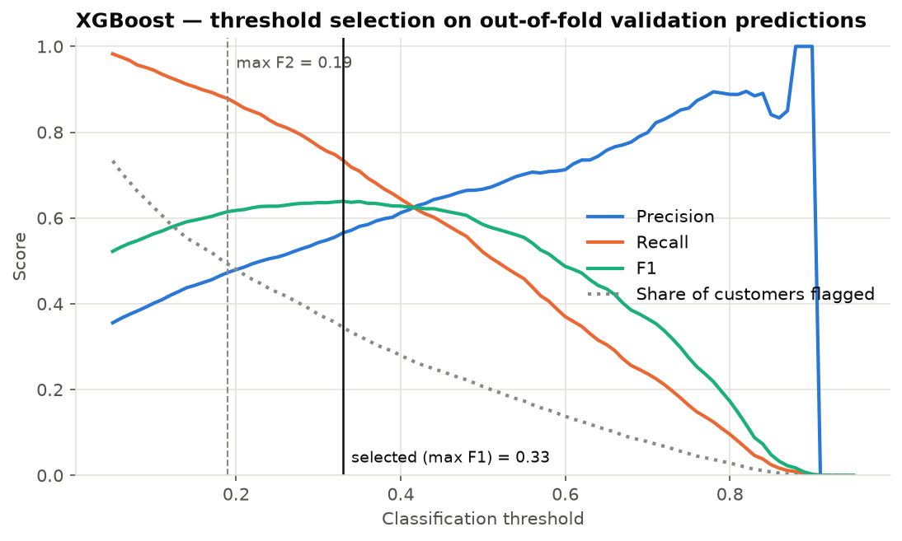
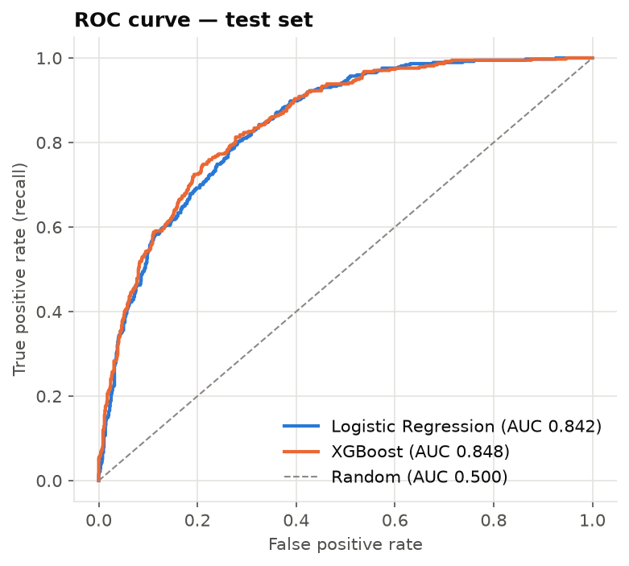
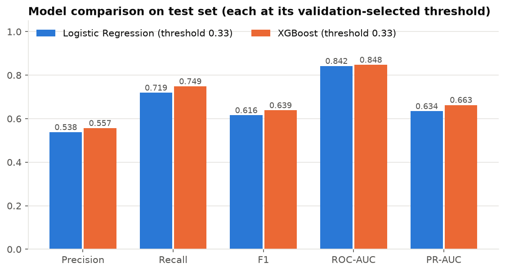
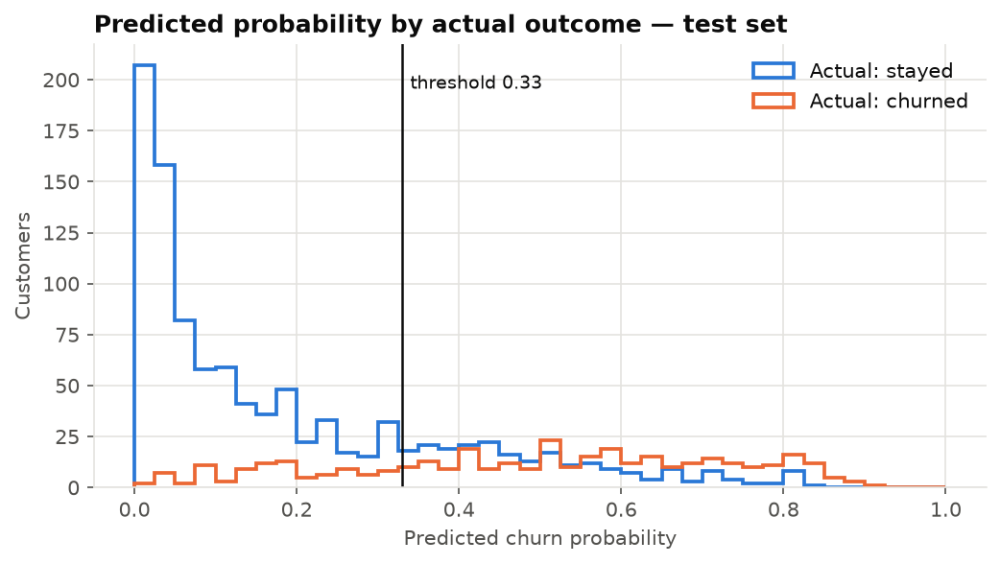
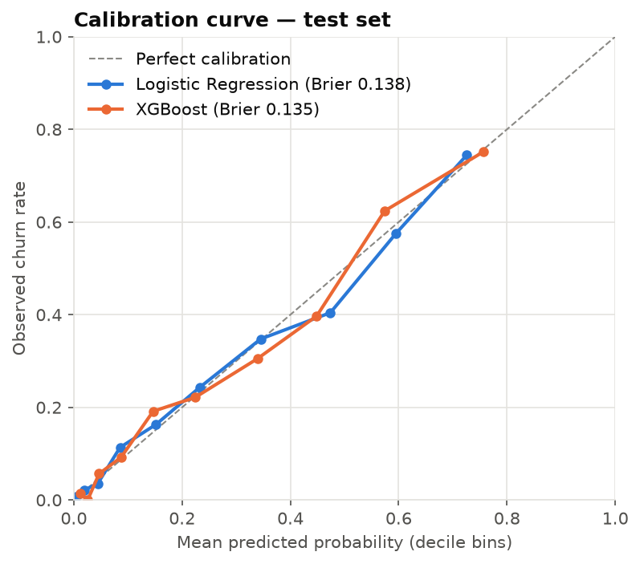

# Model Results

> Auto-generated by `src/evaluate.py` from the latest run of `python main.py`
> (model trained at 2026-10-25T17:36:54+00:00 UTC). Do not edit by hand.

## 1. Setup

- Train / test split: 5,634 / 1,409 customers, stratified
  (churn rate 26.5%), `random_state=42`.
- Model and imbalance-strategy selection: mean 5-fold CV average_precision on the training set only.
- Threshold selection: max F1 on out-of-fold training predictions.
- The test set was used **once**, for the final evaluation reported in section 3.

## 2. Cross-validation: models × class-imbalance strategies (training data)

Precision, recall, false positives (FP) and false negatives (FN) are computed on out-of-fold
predictions at the default 0.5 threshold, to show how each imbalance strategy shifts the
precision/recall trade-off. PR-AUC and ROC-AUC are threshold-free.

| Model | Imbalance strategy | CV PR-AUC | ± std | CV ROC-AUC | Precision@0.5 | Recall@0.5 | FP@0.5 | FN@0.5 | Brier |
|---|---|---|---|---|---|---|---|---|---|
| Logistic Regression | none | 0.662 | 0.019 | 0.846 | 0.653 | 0.543 | 432 | 683 | 0.135 |
| Logistic Regression | weighted | 0.660 | 0.019 | 0.846 | 0.517 | 0.801 | 1,120 | 297 | 0.165 |
| Logistic Regression | smote | 0.659 | 0.020 | 0.844 | 0.532 | 0.777 | 1,021 | 334 | 0.161 |
| XGBoost | none | 0.672 | 0.023 | 0.850 | 0.667 | 0.520 | 388 | 717 | 0.133 |
| XGBoost | weighted | 0.671 | 0.020 | 0.850 | 0.518 | 0.817 | 1,139 | 273 | 0.162 |
| XGBoost | smote | 0.665 | 0.022 | 0.847 | 0.595 | 0.664 | 677 | 502 | 0.140 |

**Selected model:** XGBoost with imbalance strategy `none` (`learning_rate=0.03`, `max_depth=3`, `min_child_weight=1`, `n_estimators=200`),
highest mean CV PR-AUC (0.672).

**Selected threshold:** 0.33 (max F1 on out-of-fold predictions).
Recall-oriented alternative (max F2): 0.19.




## 3. Final evaluation on the held-out test set

### At each model's validation-selected threshold

| Model | Strategy | Threshold | Accuracy | Precision | Recall | F1 | ROC-AUC | PR-AUC | Brier | TP | FP | FN | TN |
|---|---|---|---|---|---|---|---|---|---|---|---|---|---|
| Logistic Regression | none | 0.330 | 0.762 | 0.538 | 0.719 | 0.616 | 0.842 | 0.634 | 0.138 | 269 | 231 | 105 | 804 |
| XGBoost | none | 0.330 | 0.775 | 0.557 | 0.749 | 0.639 | 0.848 | 0.663 | 0.135 | 280 | 223 | 94 | 812 |

### At the default threshold (0.50), for reference

| Model | Strategy | Threshold | Accuracy | Precision | Recall | F1 | ROC-AUC | PR-AUC | Brier | TP | FP | FN | TN |
|---|---|---|---|---|---|---|---|---|---|---|---|---|---|
| Logistic Regression | none | 0.500 | 0.806 | 0.657 | 0.559 | 0.604 | 0.842 | 0.634 | 0.138 | 209 | 109 | 165 | 926 |
| XGBoost | none | 0.500 | 0.808 | 0.673 | 0.535 | 0.596 | 0.848 | 0.663 | 0.135 | 200 | 97 | 174 | 938 |

### Classification report — XGBoost at threshold 0.33

```text
              precision    recall  f1-score   support

    No churn      0.896     0.785     0.837      1035
       Churn      0.557     0.749     0.639       374

    accuracy                          0.775      1409
   macro avg      0.726     0.767     0.738      1409
weighted avg      0.806     0.775     0.784      1409

```

With the selected threshold the final model flags 35.7% of test customers,
detects 280 of 374 actual churners (recall 0.749) and
55.7% of flagged customers actually churned (precision).
A naive "nobody churns" classifier would reach 73.5%
accuracy with zero recall, which is why accuracy is reported only for reference.








## 4. Illustrative business impact (HYPOTHETICAL assumptions)

Assumptions (not company data): cost per targeted customer = 30
(currency units); a targeted true churner is retained with probability
25%; a retained customer is worth
12 months × MonthlyCharges × 50% gross margin.
Non-churners who are contacted generate cost but no saved value. Computed on the
1,409 test customers.

| strategy | customers_targeted | churners_reached | expected_customers_retained | expected_value_saved | campaign_cost | expected_net_value |
|---|---|---|---|---|---|---|
| Model, selected threshold (0.33) | 503 | 280 | 70 | 31,676 | 15,090 | 16,586 |
| Model, recall-oriented F2 threshold (0.19) | 680 | 321 | 80 | 35,911 | 20,400 | 15,511 |
| Model, default threshold (0.50) | 297 | 200 | 50 | 23,092 | 8,910 | 14,182 |
| Random targeting (same volume as selected) | 503 | 124 | 31 | 13,122 | 15,090 | -1,968 |
| Target all customers | 1,409 | 374 | 94 | 40,822 | 42,270 | -1,448 |

**Sensitivity of expected net value to the retention success rate:**

| Strategy | Net value @ 10% success | Net value @ 25% success | Net value @ 40% success |
|---|---|---|---|
| Model, selected threshold (0.33) | -2,420 | 16,586 | 35,592 |
| Model, recall-oriented F2 threshold (0.19) | -6,036 | 15,511 | 37,058 |
| Model, default threshold (0.50) | 327 | 14,182 | 28,037 |
| Random targeting (same volume as selected) | -9,841 | -1,968 | 5,905 |
| Target all customers | -25,941 | -1,448 | 23,046 |

These figures are scenario calculations, not measured outcomes: the real effect of any retention
action must be validated with a controlled experiment (A/B test).
